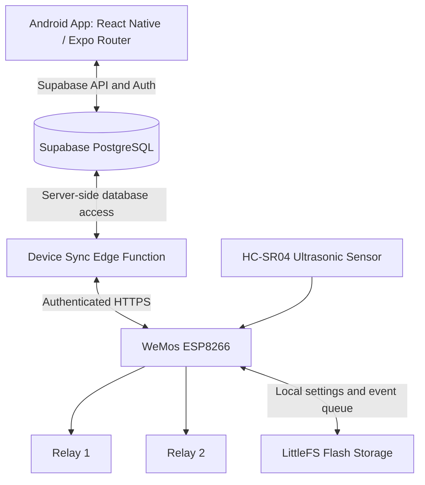

# SmartRoom IoT

**Your room. Your control. Anywhere.**


SmartRoom IoT is a personal smart-home automation project that combines an Android application, a cloud backend, and an ESP8266 controller. It is designed to control two room lights remotely over the internet and locally through ultrasonic hand gestures, even when internet connectivity is unavailable.

The project uses free and open-source development tools and Supabase's free tier, subject to service limits. No dedicated PHP or Node.js hosting is required.

## Features

- Remote control of two independent relay outputs and collective ON/OFF control.
- Email/password authentication with persistent mobile sessions.
- Device connectivity monitoring and confirmed relay-output status.
- Wave, presence, and toggle gesture modes.
- Adjustable ultrasonic detection distance and hold duration.
- Local wave-based control during internet outages.
- LittleFS storage for saved sensor settings and buffered offline events.
- Automatic reconnection, state synchronization, and duplicate-event prevention.
- Activity history and schedule management interface.
- Light and dark themes with Expo Router navigation.

> **Development status:** Phase 4 source has been prepared. Full device, Android, and cloud integration testing is required. Schedule execution, recurring schedules, countdown timers, and signed release APK distribution are planned for later phases. Reported relay output is not independent confirmation that a physical light is illuminated.

## System architecture



Cloud commands are stored with expiration times. The ESP8266 receives valid commands, applies them, and reports its output states back to the backend. Local gestures do not require the cloud.

## Technology stack

| Layer | Technology |
| --- | --- |
| Mobile application | React Native, Expo, Expo Router, TypeScript |
| Backend | Supabase Edge Functions (TypeScript / Deno) |
| Database | PostgreSQL, Supabase Row Level Security |
| Authentication | Supabase Auth, separate controller token |
| Microcontroller | WeMos D1 R1 / ESP8266 |
| Firmware | Arduino C++, ArduinoJson 7.x |
| Offline storage | LittleFS |
| Networking | Wi-Fi, HTTPS |

## Hardware requirements

| Component | Quantity |
| --- | ---: |
| WeMos ESP8266 development board | 1 |
| HC-SR04 ultrasonic sensor | 1 |
| Compatible two-channel relay module | 1 |
| 5V-to-3.3V ECHO level shifting circuit | 1 |
| Suitable low-voltage power supply and jumper wires | As needed |

Reference GPIO configuration (verify against your board and existing wiring):

| Signal | GPIO |
| --- | ---: |
| Relay 1 input | 14 |
| Relay 2 input | 12 |
| Ultrasonic TRIG | 5 |
| Ultrasonic ECHO (level shifted) | 4 |

**Electrical safety:** ESP8266 GPIOs are 3.3V. Do not connect a 5V ECHO signal directly. Verify relay input compatibility and test with the mains loads disconnected. Mains installation must be handled by a qualified electrician. Relay outputs are designed to initialize OFF after a restart; verify actual hardware boot behavior before connecting any load.

## Gesture controls

| Gesture | Action |
| --- | --- |
| One wave | Toggle Light 1 |
| Two waves | Toggle Light 2 |
| Hold for 3 seconds | Turn both lights ON if either is OFF |
| Release and hold again | Turn both lights OFF |
| Presence mode | Both outputs ON while an object is detected; OFF after the configured delay |
| Toggle mode | Toggle both outputs on a close-distance detection |

During an internet outage, the controller falls back to wave mode. Up to 32 offline relay-change events can be buffered, with up to eight uploaded per synchronization request. Additional events may be lost if the queue is full; local control continues. The controller reports current output states after reconnecting rather than relying on stale commands.

## Project structure

```text
smartroom/
├── mobile/
│   ├── src/
│   │   ├── app/
│   │   │   ├── (auth)/
│   │   │   ├── (tabs)/
│   │   │   └── _layout.tsx
│   │   ├── components/
│   │   ├── contexts/
│   │   └── lib/
│   ├── assets/
│   ├── app.json
│   └── package.json
├── firmware/
│   └── SmartRoom/
│       ├── SmartRoom.ino
│       ├── config.h          # Local only; do not commit
│       ├── offline_store.h
│       └── trust_roots.h
├── supabase/
│   ├── functions/
│   │   └── device-sync/
│   │       └── index.ts
│   ├── 001.sql
│   ├── 002.sql
│   ├── 003.sql
│   └── 004.sql
└── README.md
```

The tree shows the intended integrated Phase 4 layout. SQL files may be located elsewhere if the phase packages were extracted individually.

## Getting started

### 1. Clone the repository

```bash
git clone https://github.com/greg161616/smartroom.git
cd smartroom
```

Install Node.js, Git, Arduino IDE, and Expo Go on an Android device. Android Studio is optional for Expo Go testing but useful for emulators and local APK builds.

### 2. Configure the Supabase backend

1. Create a project at [Supabase](https://supabase.com/dashboard).
2. In SQL Editor, apply `001.sql`, `002.sql`, `003.sql`, and `004.sql` in order on a new database. For an existing installation, apply only the outstanding migrations.
3. Enable email/password authentication and copy the project URL and publishable key.
4. Register and sign in using the Android application to initialize the room and controller records.

### 3. Run the Android application

```bash
cd mobile
npm install
```

Create `mobile/.env` with your own values:

```dotenv
EXPO_PUBLIC_SUPABASE_URL=https://YOUR_PROJECT.supabase.co
EXPO_PUBLIC_SUPABASE_PUBLISHABLE_KEY=YOUR_PUBLISHABLE_KEY
```

If dependencies are missing, install SDK-compatible versions:

```bash
npx expo install @supabase/supabase-js @react-native-async-storage/async-storage react-native-url-polyfill react-native-safe-area-context react-native-screens
```

Start Expo:

```bash
npx expo start --clear
```

Scan the QR code with Expo Go. Make sure the app's `package.json` uses `expo-router/entry` as its main entry point.

### 4. Deploy the device API

From the repository root (the directory containing `supabase/`):

```bash
npx supabase login
npx supabase functions deploy device-sync --project-ref YOUR_PROJECT_REF --no-verify-jwt
```

This endpoint uses its own device-token authentication instead of user JWT verification. Do not disable JWT verification on unrelated endpoints.

Find your own controller UUID in the `devices` table, then issue a token from the Supabase SQL Editor:

```sql
SELECT public.smartroom_issue_device_token(
    'YOUR_DEVICE_UUID'::uuid
) AS device_token;
```

Issuing a replacement token invalidates the previous one. Store it privately.

### 5. Configure and upload firmware

In Arduino IDE, add the ESP8266 board manager URL:

```text
https://arduino.esp8266.com/stable/package_esp8266com_index.json
```

Install the ESP8266 board package and ArduinoJson 7.x. Open `firmware/SmartRoom/SmartRoom.ino` and create or retain a local `config.h` using the Phase 4 configuration template. Set `WIFI_SSID`, `WIFI_PASSWORD`, `SYNC_URL`, `DEVICE_ID`, and `DEVICE_TOKEN` with your own values. The sync URL format is:

```text
https://YOUR_PROJECT.supabase.co/functions/v1/device-sync
```

Select the correct board, COM port, and flash layout with filesystem storage. Verify and upload the sketch, then open Serial Monitor at **115200 baud**. Keep mains loads disconnected while testing.

Serial test commands:

| Command | Action |
| --- | --- |
| `1` | Toggle Relay 1 |
| `2` | Toggle Relay 2 |
| `a` | Both ON |
| `o` | Both OFF |
| `q` | Offline queue and storage status |

## Security and privacy

- Never commit `.env`, private firmware `config.h`, Wi-Fi passwords, device tokens, database passwords, or service-role keys.
- Use the Supabase publishable key in the mobile app and enforce Row Level Security on user-owned data.
- Keep server-side credentials in the backend and use verified TLS for device communication.
- Rotate any exposed credentials. Removing a file from Git tracking does not erase earlier commits.

Recommended `.gitignore` entries:

```gitignore
node_modules/
.expo/
dist/
.env
.env.*
!.env.example
firmware/SmartRoom/config.h
*.apk
*.elf
*.bin
```

## Roadmap

| Phase | Scope | Status |
| --- | --- | --- |
| 1 | Database and authentication | Source available |
| 2 | Android interface and navigation | Source available |
| 3 | ESP8266 and secure device API | Source available |
| 4 | Persistent offline settings and activity synchronization | Source available; testing required |
| 5 | Scheduling, countdown timers, automation | Planned |
| 6 | Signed APK and deployment | Planned |

## Author

**Greg Tomco** — Developer of SmartRoom IoT

GitHub: [@greg161616](https://github.com/greg161616)

## License

No license is declared in this README. Refer to the repository's LICENSE file if one is provided.
